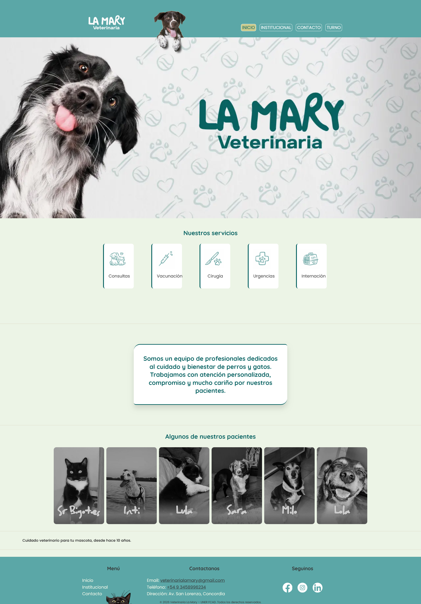
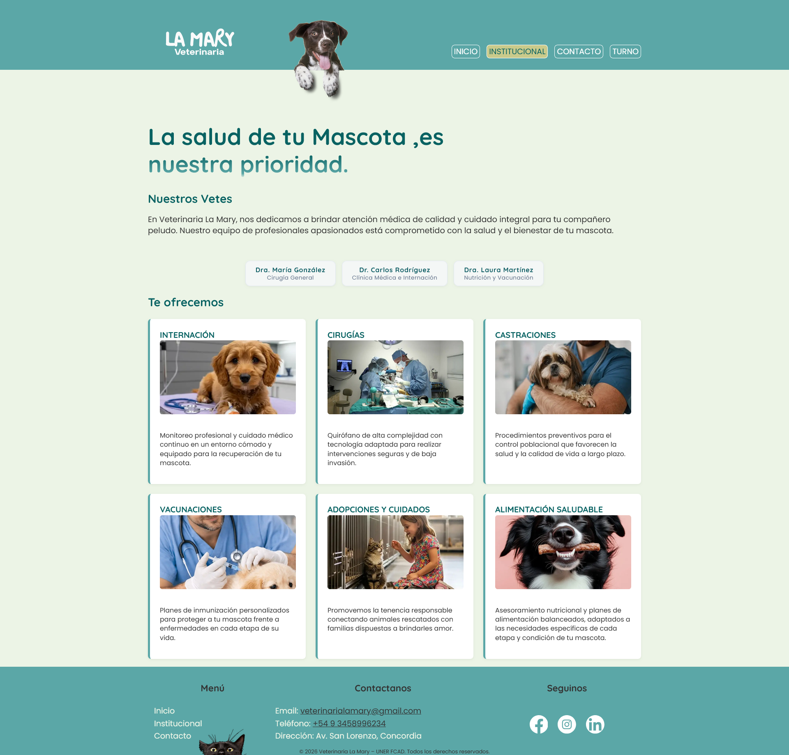
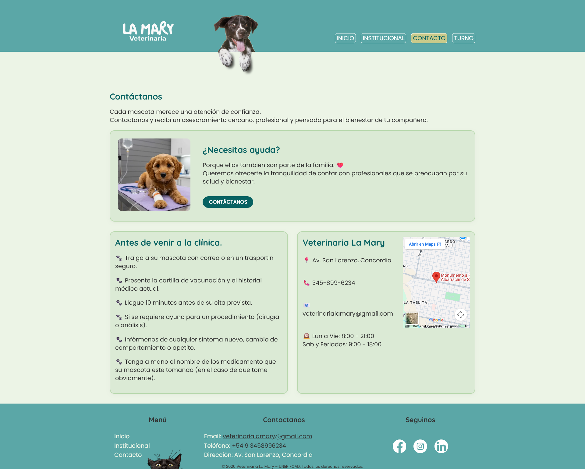

# 🐾 Veterinaria La Mary

Sitio web informativo desarrollado como práctica académica en la **Tecnicatura Universitaria en Desarrollo Web – UNER (FCAD)**.  
El proyecto busca brindar información institucional, mostrar servicios y facilitar el contacto con la clínica.

---
## 👥 Integrantes:
* Nara Belén Avila.
* Amilcar Flaquer.
* Elisa Aldana Arévalo.
* Gonzalo Rojas
---
## 📖 Descripción
La página web **Veterinaria La Mary** ofrece:
- Información sobre la clínica y sus profesionales.
- Sección de contacto y turnos online.
- Enlaces a redes sociales para seguimiento.

---

## 📂 Estructura del proyecto
```PROYECTO_VETE/
├── assets/
│   └── fonts/
│       ├── Poppins-Regular.ttf
│       └── Quicksand.ttf
├── css/
│   ├── base.css
│   ├── normalize.css
│   └── style.css
├── icons
│   └──logo_light.png
├── img/
├── js/
├── contacto.html
├── index.html
├── institucional.html
├── turno.html
├── package-lock.json
├── package.json
└── README.md
```
---

## 📷Capturas

>* Figura N° 1  de portada


>* Figura N° 2 imagen de institucional


>* Figura N° 3 imagen de contacto